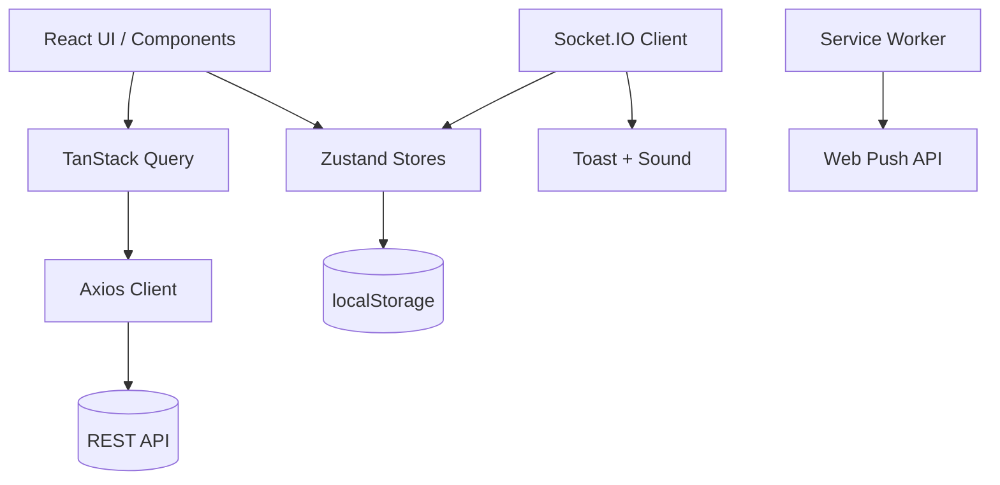
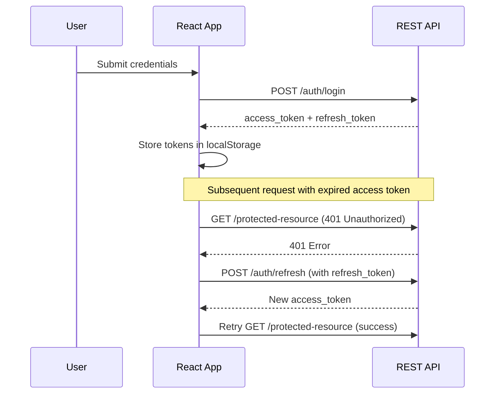
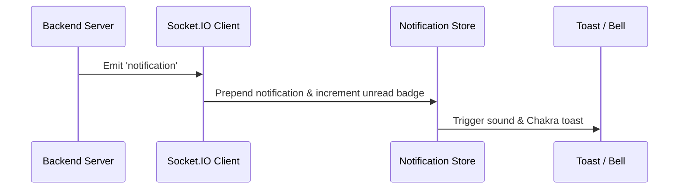

# RailMonitor — Sensor Dashboard

A high-performance, responsive React and TypeScript frontend dashboard built for real-time monitoring of embedded vibration sensors, telemetry streams, device health states, and push notifications. Designed as the companion frontend for the railway vibration monitoring system (PFE).

## Tech Stack

- **Core:** React 19, TypeScript 5.9 (strict mode)
- **Build Tool:** Vite 8
- **UI Framework:** Chakra UI 3 + Emotion
- **State & Data Fetching:** TanStack Query 5, Zustand 5
- **Networking:** Axios 1 (JWT interceptors + refresh rotation), Socket.IO Client 4
- **Routing:** React Router 7
- **Forms & Validation:** React Hook Form 7, Zod 4, `@hookform/resolvers`
- **Charts:** Recharts 3
- **Push Notifications:** Web Push API + Service Worker
- **Icons & Utilities:** react-icons 5, jwt-decode 4, use-debounce 10

## Quick Start

### Prerequisites

- **Node.js:** `^20.19.0 || >=22.12.0` (required by Vite 8)
- **npm**

### Installation & Running

```bash
# 1. Clone the repository and install dependencies
npm install

# 2. Configure environment variables
cp .env.example .env        # Windows: Copy-Item .env.example .env
# Edit .env: set VITE_API_URL and VITE_VAPID_PUBLIC_KEY

# 3. Start the development server
npm run dev
```

The app fails fast at startup if a required variable is missing. See [Environment Variables](#environment-variables).

## Environment Variables

Copy `.env.example` to `.env` and adjust the values. All `VITE_*` variables are exposed to the browser — never put secrets here.

| Variable | Required | Description |
| --- | --- | --- |
| `VITE_API_URL` | Yes | Backend API origin, e.g. `http://localhost:3000`. Trailing slashes are trimmed. |
| `VITE_SOCKET_URL` | No | Socket.IO notifications URL. Defaults to `${VITE_API_URL}/notifications`. |
| `VITE_VAPID_PUBLIC_KEY` | Yes | Web Push public key; must match the backend's `VAPID_PUBLIC_KEY`. |

Values are read through `src/config/env.ts`, which throws a descriptive error when a required variable is missing.

For production, create `.env.production.local` (gitignored) or provide the variables in CI. Vite inlines them at build time.

## Feature Matrix

| Module | User-Facing Behavior | Key Files |
| :--- | :--- | :--- |
| **Auth** | JWT login, refresh-token rotation on 401, `/auth/` loop guard, expiry check with logout + query-cache clear, redirect to home after login | `src/api/axios.ts`, `src/hooks/useAuth.ts`, `src/components/shared/ProtectedRoute.tsx`, `src/store/auth.store.ts` |
| **Dashboard** | Device summary counts (total/active/inactive), recent notifications, quick actions, recently added devices | `src/pages/dashboard/HomePage.tsx` |
| **Devices** | 10/page pagination, 400 ms debounced name search, active/inactive filter, create/edit, activate/deactivate, API-key copy/refresh, responsive table/cards | `src/pages/devices/DevicesPage.tsx`, `src/components/devices/` |
| **Sensor Windows** | Per-device analysis, 1/6/12/24 h ranges, RMS trend chart with X/Y/Z toggles, 500-point downsampling, device info and recent notifications | `src/pages/sensor-windows/SensorWindowsPage.tsx`, `src/components/sensor-windows/` |
| **Sensor Detail** | Speed, satellites, GPS sync badge, OpenStreetMap embed, RMS/P2P per axis (Y/Z), dominant axis | `src/pages/sensor-windows/Sensorwindowdetailpage.tsx`, `src/components/sensor-windows/` |
| **Notifications** | Socket.IO realtime, toast + sound, bell popover with unread badge, filters (state/severity/date range), 12/page pagination, unread highlighting, state workflow, detail drawer | `src/pages/notification/Notificationspage.tsx`, `src/hooks/useNotifications.ts`, `src/components/notifications/` |
| **Web Push** | Service worker, VAPID subscribe/unsubscribe, re-sync on load, auto-unsubscribe on logout, permission prompt, profile toggle | `public/sw.js`, `src/hooks/useWebPush.ts`, `src/components/notifications/PushSetupPrompt.tsx`, `src/components/notifications/PushToggle.tsx` |
| **Admin** | Stats cards, user search/role/active filters, 10/page pagination, create user, activate/deactivate, password reset, responsive table/cards | `src/pages/stat/adminPage.tsx`, `src/components/Users/`, `src/components/stats/` |
| **Profile** | Edit first/last name, role/status badges, push toggle | `src/pages/profile/ProfilePage.tsx` |

## Architecture

### System Flow



### Login & Refresh-Token Retry Flow



### Socket.IO Notification Flow



## Configuration Reference

| Configuration Key | Purpose | Default / Location |
| :--- | :--- | :--- |
| `VITE_API_URL` | Build-time REST base URL | `http://localhost:3000` in `.env.example` |
| `VITE_SOCKET_URL` | Socket.IO notifications endpoint | `${VITE_API_URL}/notifications` when unset |
| `VITE_VAPID_PUBLIC_KEY` | Web Push application server key | `.env.example` |
| `Service Worker` | Background push worker script | `public/sw.js` |
| `Token Keys` | LocalStorage auth keys | `access_token` / `refresh_token` |
| `Push Dismissal` | Push prompt dismissal state | `push_prompt_dismissed` (localStorage) |

## Routes and Pages

| Route Path | Access Level | Description |
| :--- | :--- | :--- |
| `/login` | Public | Authentication portal |
| `/` | Authenticated | Main dashboard |
| `/devices` | Authenticated | Device inventory & management |
| `/devices/:deviceId/sensor-windows` | Authenticated | Time-series sensor vibration windows |
| `/sensor-windows/:id` | Authenticated | Detailed sensor analysis & GPS view |
| `/notifications` | Authenticated | Alert history & state workflow |
| `/profile` | Authenticated | User profile & push preferences |
| `/admin` | Admin UI | User administration & system stats |

> `/admin` is hidden from non-admin navigation, but the route itself only checks authentication. Admin mutations must be authorized by the backend.

## API Contract

- **Auth:** `POST /auth/login`, `POST /auth/refresh`, `POST /auth/register`
- **Devices:** `GET/POST /device`, `GET/PATCH /device/:id`, `PATCH /device/:id/activate`, `PATCH /device/:id/deactivate`, `PATCH /device/:id/refresh-api-key`
- **Sensor Windows:** `GET /sensor-windows`, `GET /sensor-windows/:id`, `GET /sensor-windows/:deviceId/analysis`
- **Notifications:** `GET /notifications`, `PATCH /notifications/:id/state`
- **Users & Admin:** `GET /users`, `PATCH /users/:id/activate`, `PATCH /users/:id/deactivate`, `PATCH /users/:id/password`, `PATCH /users/profile`, `GET /stats`
- **Push:** `POST /push/subscribe`, `DELETE /push/unsubscribe`
- **Real-time:** Socket.IO at `VITE_SOCKET_URL` (default `${VITE_API_URL}/notifications`), JWT passed as `auth.token`, event name `notification`

## Data Models

```typescript
// src/types/user.types.ts
export type UserRole = "admin" | "user";

export interface User {
  id: number;
  firstName: string;
  lastName: string;
  email: string;
  role: UserRole;
  isActive: boolean;
  createdAt: string;
  updatedAt: string;
}

// src/types/auth.types.ts
export interface JwtPayload {
  id: number;
  firstName: string;
  lastName: string;
  email: string;
  role: string;
  isActive: boolean;
  exp: number;
}

// src/types/device.types.ts
export interface Device {
  id: number;
  name: string;
  isActive: boolean;
  createdAt: string;
  updatedAt: string;
  createdBy: JwtPayload;
  apiKey: string | null;
}

// src/types/sensorWindow.types.ts
export interface SensorWindow {
  id: number;
  recordedAt: string;
  lat: number | null;
  lon: number | null;
  speedKmph: number | null;
  satellites: number | null;
  gpsSynced: boolean;
  analysis?: VibrationAnalysis;
}

export interface VibrationAnalysis {
  rms: { x: number; y: number; z: number };
  peakToPeak: { x: number; y: number; z: number };
  fft: {
    dominantFreq: number;
    amplitude: number;
    peaks: { freq: number; amplitude: number }[];
    spectrum?: { freq: number; amplitude: number }[];
    freqResolution: number;
  };
  processedAt: string;
  windows?: VibrationAnalysis[];
}

// src/types/notification.types.ts
export type NotificationState =
  | "unread"
  | "in_investigation"
  | "resolved"
  | "dismissed";

export type SeverityLevel = "low" | "medium" | "high" | "critical";

export interface Notification {
  id: number;
  deviceId: number;
  userId: number;
  sensorWindowId: number;
  sensorWindowTime: string;
  state: NotificationState;
  severity: SeverityLevel;
  message: string;
  createdAt: string;
  resolvedAt: string | null;
  device?: { id: number; name: string };
  sensorWindow?: SensorWindow;
}
```

## State, Caching, and Performance

- **TanStack Query defaults:** 30 s stale time with 1 automatic retry.
- **Sensor analysis cache:** 24 h stale time and garbage-collection time to avoid refetching heavy payloads.
- **Chart optimization:** high-frequency sensor series are downsampled client-side to a maximum of **500 points**.
- **Debouncing:** device and admin search inputs are debounced at **400 ms**.
- **Pagination limits:**
  - Devices: 10/page
  - Notifications: 12/page
  - Users: 10/page
  - Sensor analysis: 20 records/page (client-side slice)
- **Responsive breakpoints:** the sidebar collapses into a mobile drawer below `md`; data tables switch to card grids below `lg`.

## Project Structure

```text
src/
├── api/          # Axios instance + endpoint modules
├── components/   # Reusable UI (devices, layout, notifications, sensor-windows, shared, stats, ui, Users)
├── config/       # Typed environment accessor
├── hooks/        # TanStack Query wrappers + Socket.IO / Web Push hooks
├── pages/        # Route views (auth, dashboard, devices, notification, profile, sensor-windows, stat)
├── schemas/      # Zod validation schemas
├── store/        # Zustand stores (auth, notifications, sidebar)
├── types/        # TypeScript interfaces
├── utils/        # Token storage and validation helpers
public/
└── sw.js         # Service Worker for Web Push
```

## Scripts and Quality Gates

- `npm run dev` — starts the Vite development server.
- `npm run build` — runs TypeScript type-checking (`tsc -b`) followed by Vite production bundling.
- `npm run preview` — locally previews the production build.
- `npm run lint` — runs ESLint across the codebase.
- **Note:** strict TypeScript is enforced and ESLint uses the flat configuration. No automated test framework is configured in this repository.

## Git Flow and Releases

- `main` — stable production releases (tagged `v0.1.0` through `v0.6.0`).
- `dev` — primary integration branch.
- `feature/*` — developed off `dev` and merged back via pull request.
- `release/*` — preparation branch for production tagging.
- `hotfix/*` — patches branched from `main` and back-merged to `dev`.

```text
main -----o-------o (v0.6.0)
         /       /
dev ----o---o---o---o
           /     \
feature --o       o--
```

## Deployment Notes

- **Build output:** production artifacts are compiled into `dist/`.
- **SPA fallback:** static hosting servers (Nginx, Apache, Vercel) must route all requests back to `index.html`.
- **Environment injection:** `VITE_API_URL`, `VITE_SOCKET_URL`, and `VITE_VAPID_PUBLIC_KEY` are baked into the bundle at build time. Set production values before running `npm run build`.
- **Web Push security:** requires `HTTPS` or `localhost` to register service workers and request notification permissions.
- **CORS & Socket.IO:** the companion backend must allow the frontend origin via CORS and expose the notifications Socket.IO namespace (or match `VITE_SOCKET_URL`).

## Troubleshooting

| Issue | Cause | Solution |
| :--- | :--- | :--- |
| **401 Loop / Immediate Logout** | Invalid refresh token or missing `/auth/refresh` handling | Clear localStorage tokens, verify backend JWT expiration windows and secret keys. |
| **CORS Errors** | Frontend origin mismatched in backend CORS configuration | Ensure the backend allows `http://localhost:5173` (or your deployment origin). |
| **Socket.IO Connection Failure** | Incorrect URL/namespace or backend offline | Verify `VITE_SOCKET_URL` (or the `${VITE_API_URL}/notifications` default) and confirm the backend namespace is active. |
| **Push Permission Denied / VAPID Mismatch** | Browser blocked notifications or public VAPID key mismatch | Reset site permissions in browser settings; verify `VITE_VAPID_PUBLIC_KEY` matches the backend's `VAPID_PUBLIC_KEY`. |
| **Missing Required Environment Variable** | `VITE_API_URL` or `VITE_VAPID_PUBLIC_KEY` is unset | Copy `.env.example` to `.env` and fill in both required values, then restart the dev server. |
| **Production Build Points at localhost** | Build ran with the local `.env` | Create `.env.production.local` or set CI environment variables, then rebuild. |
| **Node Version Mismatch** | Running on Node `< 20.19.0` | Upgrade Node.js using `nvm install --lts`. |
| **Strict TypeScript Build Failures** | Implicit `any` types or unused variables | Run `npm run lint` and fix type annotations before building. |

## Known Limitations & Roadmap

- Authentication tokens are stored in `localStorage`; an `httpOnly` cookie architecture is planned for future iterations.
- Admin UI visibility is enforced client-side; the backend must validate authorization on all admin mutations.
- Automated test suites (Vitest/Playwright) and CI pipelines are pending.

## Academic Context

This repository represents the frontend component of a Final-Year Engineering Project (PFE) and requires the companion backend API service to function fully.
